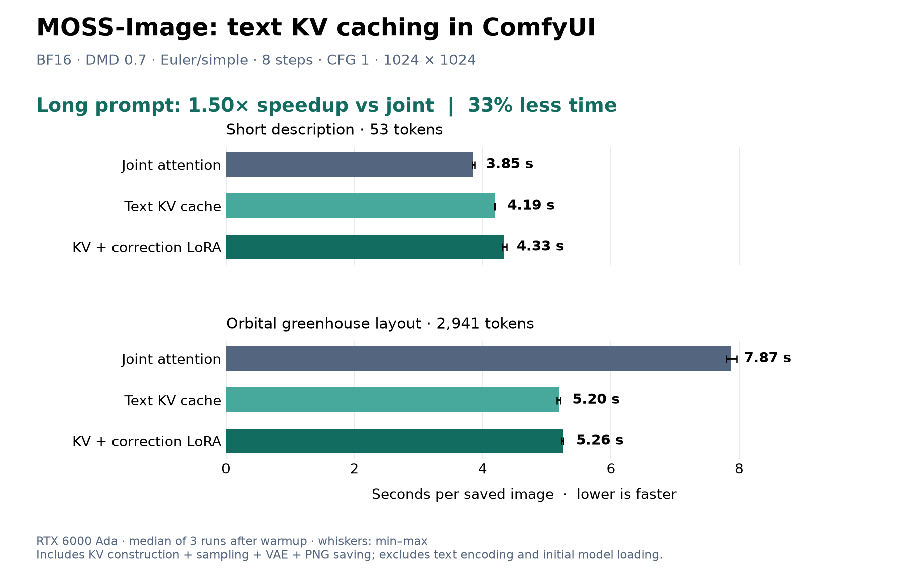
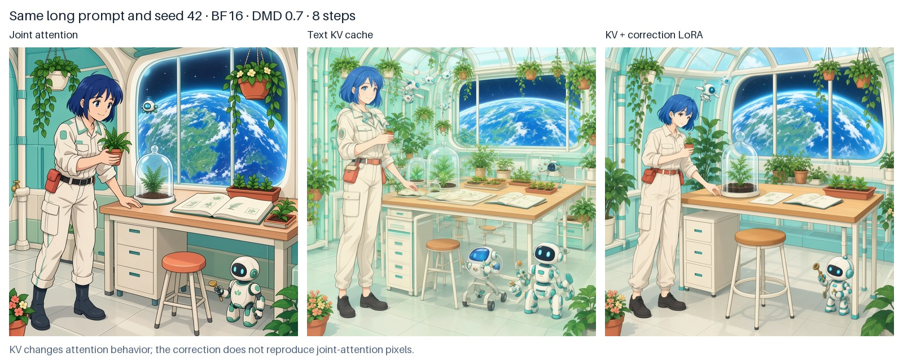

# MOSS-Image Text KV Cache for ComfyUI

Generate images with [MOSS-Image-SFT](https://huggingface.co/OpenMOSS-Team/MOSS-Image-SFT) while computing the text-side attention keys and values only once per sampling run. This saves repeated work on long prompts, including detailed JSON scene layouts.

The **MOSS-Image Text KV Cache** node works with ComfyUI's native MOSS-Image model and standard samplers. A separate [correction LoRA](https://huggingface.co/p1atdev/MOSS-Image-SFT-KV-Cache-LoRA) helps compensate for the change in attention behavior. Both the correction and the 8-step DMD adapter load through ComfyUI's built-in **Load LoRA (Model Only)** node.

## Install

Use a recent ComfyUI version with native MOSS-Image support (`CLIPLoader` must offer `moss_image`). ComfyUI 0.41.0 is supported.

From your ComfyUI directory:

```bash
git clone https://github.com/p1atdev/comfy-moss-image-kv-cache.git custom_nodes/comfy-moss-image-kv-cache
```

Restart ComfyUI. The custom node needs no additional runtime packages.

## Download models

Download the following files into the indicated folders under `ComfyUI/models/`. The base components are provided by [Comfy-Org/MOSS-Image](https://huggingface.co/Comfy-Org/MOSS-Image).

| Folder | File |
| --- | --- |
| `diffusion_models/` | [moss_image_sft_bf16.safetensors](https://huggingface.co/Comfy-Org/MOSS-Image/resolve/main/diffusion_models/moss_image_sft_bf16.safetensors) |
| `text_encoders/` | [qwen3.5_9b_bf16.safetensors](https://huggingface.co/Comfy-Org/MOSS-Image/resolve/main/text_encoders/qwen3.5_9b_bf16.safetensors) |
| `vae/` | [flux2-vae_small.safetensors](https://huggingface.co/Comfy-Org/MOSS-Image/resolve/main/vae/flux2-vae_small.safetensors) |
| `loras/` | [lora_latest.safetensors](https://huggingface.co/lodestones/MOSS-Image-SFT-8-steps-dmd/resolve/f95df83b5e90ae91ea412434b3f9b7f1c8c6314f/lora_latest.safetensors) — 8-step DMD adapter |
| `loras/` | [moss_image_sft_kv_cache_v1_step000100.safetensors](https://huggingface.co/p1atdev/MOSS-Image-SFT-KV-Cache-LoRA/resolve/main/moss_image_sft_kv_cache_v1_step000100.safetensors) — KV correction adapter |

The DMD link pins the revision used to train the correction. The correction adapter contains neither the base model nor the DMD adapter. Use the **SFT** base model.

## Generate an image

1. Download [the example workflow](examples/moss_kv_cal100.json) and drag it into ComfyUI.
2. Select the downloaded files in the model, text encoder, VAE and two LoRA loaders.
3. Edit the positive prompt and click **Run**. The example includes a detailed orbital-greenhouse scene layout.

The model path is:

```text
Load Diffusion Model
  → Load LoRA (Model Only): DMD, strength 0.7
  → Load LoRA (Model Only): KV correction, strength 1.0
  → MOSS-Image Text KV Cache, text_timestep 1000
  → KSampler
```

Recommended settings: **Euler / simple / 8 steps / CFG 1**, 1024×1024, `EmptyFlux2LatentImage`, and `CLIPLoader` type `moss_image`. For BF16 text encoding, launch ComfyUI with `--bf16-text-enc`.

For API clients, [moss_kv_cal100_api.json](examples/moss_kv_cal100_api.json) contains the same graph. Submit it to `/prompt`, or run:

```bash
python custom_nodes/comfy-moss-image-kv-cache/examples/queue_prompt.py
```

## Speed with long prompts



For the 2,941-token prompt, **KV + correction reduces generation time from 7.87 s to 5.26 s: 1.50× faster, or 33% less time**. The 53-token prompt becomes slower (3.85 s → 4.33 s).

All conditions use the BF16 SFT model with split Q/K/V projections, BF16 text encoder, DMD strength 0.7, Euler/simple, 8 steps, CFG 1, batch 1 and 1024×1024 on an RTX 6000 Ada. Bars show the median of three runs after one warmup per condition; whiskers show the minimum and maximum. Timing covers fresh KV construction, sampling, VAE decoding and PNG saving, measured from KSampler start to SaveImage completion over the local WebSocket API. Text encoding and initial model loading are excluded. These numbers describe warm generation; total startup latency also includes model loading and text encoding.

The long prompt describes one scene with explicit object regions; its full text is in [benchmark_prompts.json](examples/benchmark_prompts.json). [Raw measurements](benchmarks/rtx6000ada_bf16.json) and [the benchmark script](scripts/benchmark.py) are included. To repeat the experiment with an idle ComfyUI server:

```bash
python custom_nodes/comfy-moss-image-kv-cache/scripts/benchmark.py --output benchmark.json
```



The images use the same long prompt and seed 42. They illustrate output changes rather than a controlled quality score.

## How it works and limitations

Ordinary joint attention lets text tokens attend to image tokens at every denoising step. This node instead computes text-only attention at a fixed timestep, caches each layer's K/V tensors, and reuses them while updating the image tokens. The cache is rebuilt for each sampling run, so a new prompt or LoRA configuration does not reuse stale tensors.

This changes the model's predictions. The correction LoRA reduces that difference but does not make cached attention equivalent to joint attention; composition, details and prompt adherence can still change. It is an experimental adapter trained on a small prompt set. Benefits depend on prompt length and hardware, and short prompts may see little benefit or become slower. KV tensors also consume VRAM.

To compare with ordinary joint attention, bypass **both** the KV node and the correction LoRA, keeping the DMD adapter and sampling settings the same. Keep `text_timestep` at **1000** for the supplied correction. Sampling hooks that change LoRA weights during a run are unsupported.

The node supports native split and fused QKV models, batched latents and CFG. The published benchmark uses BF16; other weight formats and different DMD strengths have not been evaluated here.
